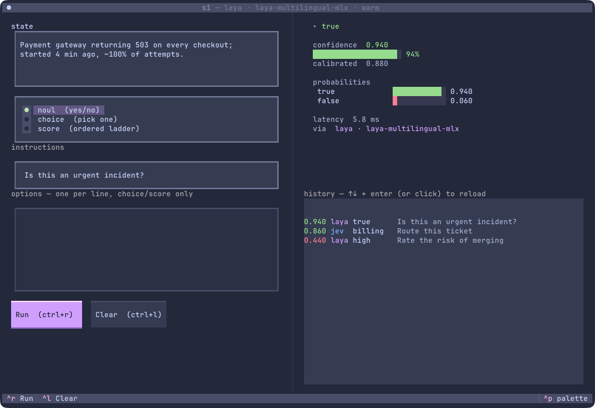
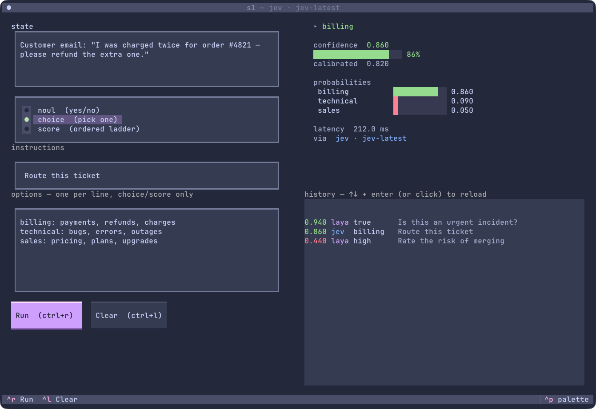
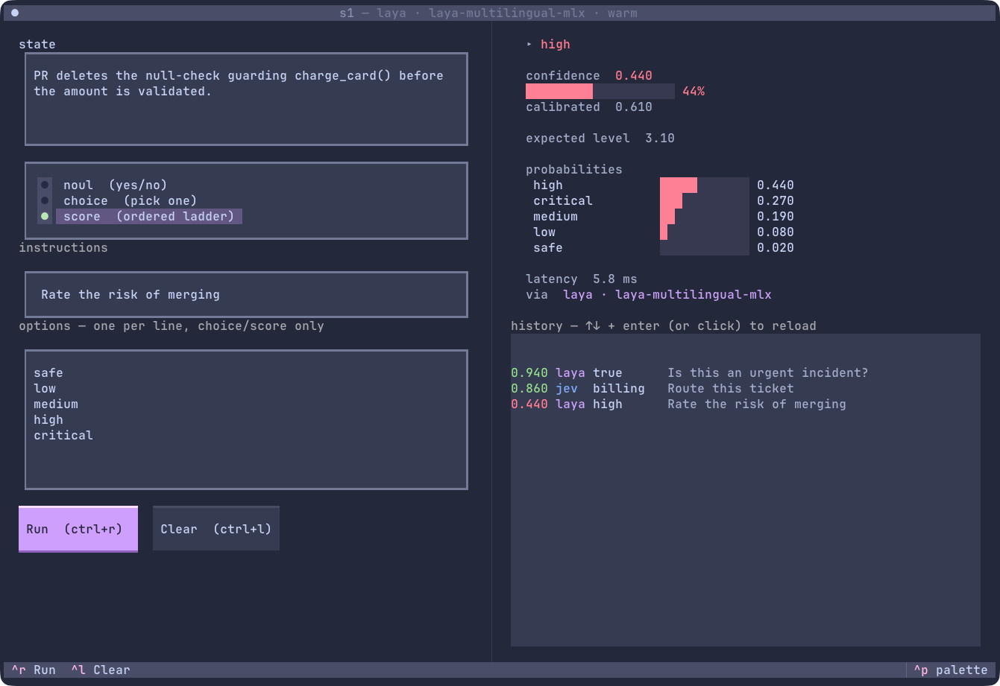
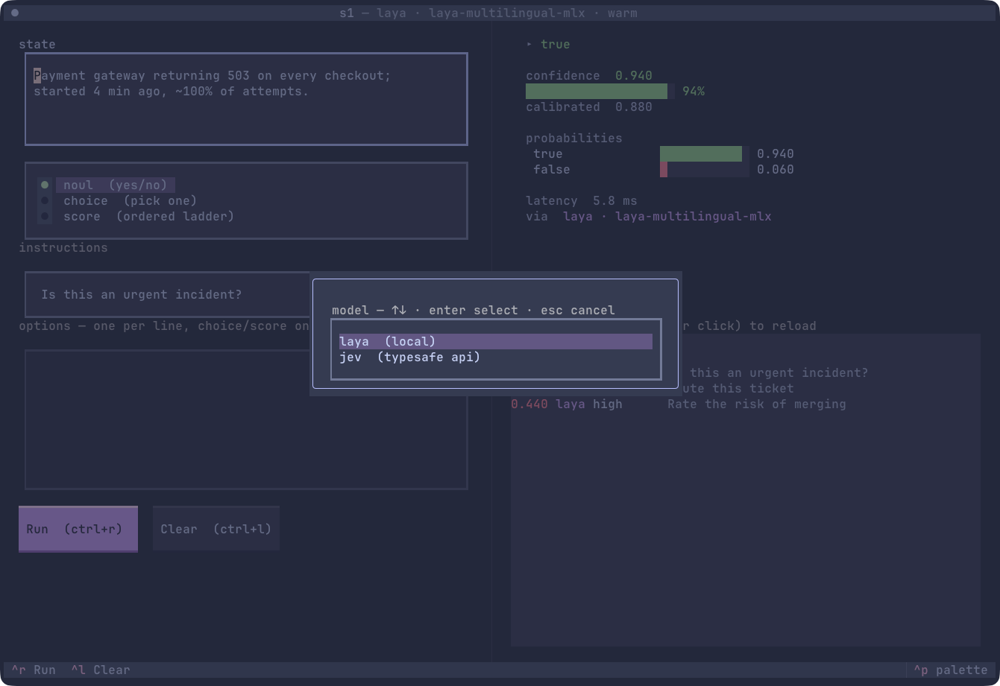

<p align="center"></p>

# s1

A terminal UI for **System One** typed decisions. Type a *state* and a *question*,
get back a typed answer — yes/no, a pick, or a score — with a calibrated confidence
and the full probability spread.



## What it is

System One models ("Jev"-style) answer one question about one state in a single
forward pass. They return **typed, calibrated decisions**, not text. s1 is a small
[Textual](https://textual.textualize.io/) front-end over two interchangeable backends:

| Backend | Where | Model | Notes |
|---------|-------|-------|-------|
| **laya** | local | `laya-multilingual-mlx` | runs on-device (MLX, Apple Silicon), loaded once, ~6 ms/decision, no key, no network |
| **jev**  | hosted API | `jev-latest` (TypeSafe) | `POST /v1/systemone`, needs an API key |

Switch backend live from the command palette (`ctrl+p` → **Model**).

## Three decision types

| Type | Question shape | Options | Answer |
|------|----------------|---------|--------|
| **noul** | yes / no | — | `p(true)` ∈ [0,1] |
| **choice** | pick one | `label: description` per line | the chosen label + probabilities |
| **score** | ordered ladder | one level per line, low → high (2–10) | expected level + probabilities |

> **choice** criteria may be bare labels *or* `label: description` lines.
> **score** is always an ordered list, lowest first — never descriptions.

## Install & run

Needs [uv](https://docs.astral.sh/uv/). The default install is **jev-only** (works
anywhere). The local `laya` backend is an opt-in extra and needs **Apple Silicon**.

```bash
git clone https://github.com/tnaftali/s1-tui s1 && cd s1

uv run s1                 # jev-only (hosted; needs an API key, see below)
uv run --extra local s1   # + local laya backend (Apple Silicon, downloads weights once)

# …or run straight from git, no clone:
uvx --from git+https://github.com/tnaftali/s1-tui s1
```

For the hosted **jev** backend set a key (no local model needed):

```bash
export TYPESAFE_API_KEY=sk-...   # JEV_API_KEY also accepted
```

The first `--extra local` run downloads the laya weights (a few hundred MB) once.

## Using it

1. Type the **state** (the thing to judge) in the left box.
2. Pick **noul / choice / score**.
3. Write the **instructions** (the question).
4. For choice/score, fill **options** (one per line).
5. `ctrl+r` (or **Run**).

The right pane shows the pick, its confidence bar, the calibrated-confidence signal,
and every option's probability.

### Routing a ticket (choice)



### Rating risk (score)



### Switching backend



## History & logging

Every run appends one JSON line to `s1_runs.jsonl` (override with `$S1_LOG`):

```json
{"ts":"…","backend":"laya","model":"…","state":"…","type":"choice",
 "instructions":"…","criteria":{…},"selected":"billing","confidence":0.86,
 "probabilities":{…},"answer":{…},"latency_ms":5.8}
```

The right-hand **history** pane reads that log on startup, so past runs survive
restarts. `↑↓ + enter` (or click) reloads a run's inputs *and* its stored answer —
no re-run. The log is per-machine and git-ignored.

## Keys

| Key | Action |
|-----|--------|
| `ctrl+r` | run |
| `ctrl+l` | clear |
| `ctrl+p` | command palette (theme, **model**, screenshot…) |
| `ctrl+c` | quit |

## Why calibrated confidence matters

The number next to the answer is meant to track real accuracy, so you can **gate**:
decide the easy, high-confidence cases locally and escalate the low-confidence ones.
In one independent benchmark (308 human-labelled cases), `laya` and `jev` were the
calibration standouts — expected calibration error ≈ 0.07, roughly half that of the
other local models tested. Calibration is dataset-dependent, so validate the threshold
on your own data before trusting it.
